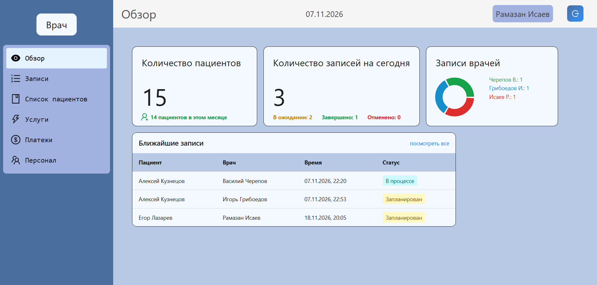
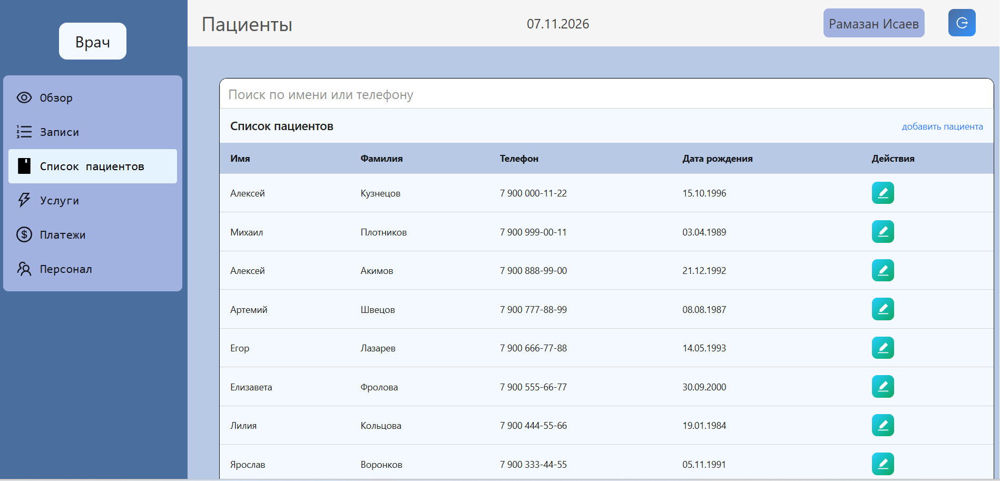
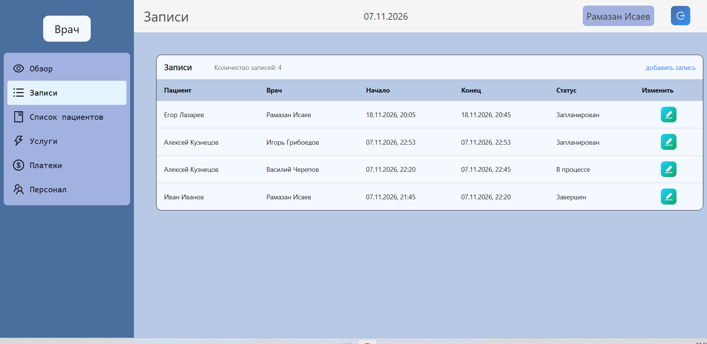
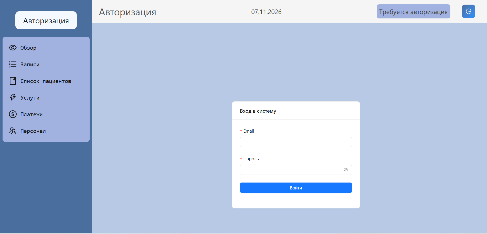

# Dental Clinic CRM

SPA для управления стоматологической клиникой: пациенты, визиты, услуги,
платежи и персонал с ролевым доступом.

Статус проекта: **MVP**. 

---
## Используемые технологии в проекте

- **React 19, TypeScript, Vite 7**.
- **RTK Query** – один базовый `api` с `prepareHeaders` (JWT), доменные
  слайсы через `injectEndpoints`, тонкая настройка `providesTags` /
  `invalidatesTags` по доменам и по записям.
- **Централизованная обработка ошибок** – Redux middleware ловит rejected
  мутации, `normalizeError` приводит их к понятному тексту, `antd`-уведомление
  показывается через bridge.
- **JWT + роли** `admin` / `doctor` / `assistant`, защита приватных роутов.
- **Дашборд** с карточками метрик и donut-графиком.
- **UI**: Ant Design 6 + Tailwind 4, кастомная светлая палитра локальный шрифт JetBrains Mono.

## Демонстрация проекта

- 🌐 **Фронтенд**: https://dental-clinic-react-vite.vercel.app
- ⚙️ **Бэкенд**: отдельный Vercel-проект (REST API)
- 🗄 **БД**: PostgreSQL на хостинге [ONREZA](https://onreza.ru)

Демо-доступ – по запросу.

<!--  -->
<!--  -->
<!--  -->
<!--  -->

## Возможности

### Авторизация и роли
- Вход по email + паролю (`POST /auth/login`), JWT сохраняется в
  `localStorage`, `prepareHeaders` подставляет `Authorization: Bearer <token>`
  во все запросы.
- Защита приватных маршрутов через `<RouteProtect />` (`<Outlet />` либо
  редирект на `/login`).
- Роли: `admin` (администратор), `doctor` (врач), `assistant` (ассистент).
  Название роли показывается в сайдбаре; у пользователя есть флаг `is_active`.
- На 401 любой запрос автоматически разлогинивает и редиректит на `/login`
  (с очисткой `token` / `user`).

### CRUD по доменам
- **Пациенты** – таблица с поиском (debounce 500 мс), модалка создания и
  редактирования, форматирование телефона и даты рождения, Zod-валидация.
- **Визиты** – список с фильтром и статусами
  `scheduled` / `in_progress` / `completed` / `cancelled` / `no_show`,
  привязка пациента и услуг (M2M через `visit_service`).
- **Услуги** – справочник с ценами.
- **Платежи** – учёт оплат по визитам.
- **Персонал** – создание/редактирование пользователей (включая смену
  пароля и `is_active`) – только для администратора.

### Дашборд
- **Карточка «Количество пациентов»** – всего + сколько добавилось в
  текущем месяце (по `created_at`).
- **Карточка «Записи на сегодня»** – общее число визитов на сегодня
  с разбивкой на «В ожидании / Завершено / Отменено».
- **Карточка «Записи врачей»** – donut-график (Recharts) распределения
  сегодняшних визитов по врачам.
- **Таблица «Ближайшие записи»** – берёт `scheduled` + `in_progress`
  с `start_time ≥ начало сегодня`, сортирует по времени, показывает top-5,
  ссылка «посмотреть все» ведёт на `/visits`.

### UX и технические детали
- **Централизованная обработка ошибок**:
  - `normalizeError` (`src/app/errors.ts`) понимает `FetchBaseQueryError`
    всех типов (`FETCH_ERROR` / `TIMEOUT_ERROR` / `PARSING_ERROR` /
    `CUSTOM_ERROR`), вытаскивает `message`/`errors` из тела ответа,
    маппит HTTP-статусы на русский текст, игнорирует `AbortError`.
  - `errorMiddleware` показывает уведомление только для **мутаций**,
    дедуплицирует одинаковые тексты окном 3 секунды – чтобы каскад
    упавших запросов не давал спам.
  - GET-ошибки обрабатываются на уровне таблицы: при наличии устаревших
    данных показывается бейдж «Не удалось обновить данные», а не падение
    экрана.
- **Antd-bridge**: `App.useApp()` доступен только внутри React-дерева,
  а `errorMiddleware` работает вне его. Компонент `AntdBridge` кладёт
  `message` / `notification` в модульный объект `antdBridge`, и middleware
  берёт их оттуда. Это позволяет показывать уведомления из Redux без хаков.
- **Skeletons и фоновое обновление** – `<TableSkeletonRows />` при первой
  загрузке, тонкая анимированная полоса прогресса при refetch
  (кастомная `@keyframes progress`).
- **Поиск с debounce** – `<SearchInput />` сам держит 500 мс задержку,
  при очистке поля срабатывает мгновенно.
- **Code-splitting** – все защищённые страницы через `React.lazy` под
  `<Suspense>`; в `vite.config.ts` – `manualChunks` для `react`, `redux`,
  `antd`, `charts`.
- **Тема и типографика** – палитра `--color-1..5` и статусные
  `success` / `process` / `quit` / `wait` в `index.css` (директива
  `@theme inline`), локальный `JetBrainsMono-VariableFont_wght.ttf`
  подключён через `@font-face` с `font-display: swap`.
- **Refetch on focus/reconnect** – `setupListeners(store.dispatch)`
  в `store.ts`.

## Стек

**Frontend**
- React 19.2 + TypeScript 5.9
- Vite 7 + `@vitejs/plugin-react`
- React Router 7
- Redux Toolkit 2 + RTK Query + react-redux
- Ant Design 6 + `@ant-design/icons` + `antd-style`
- Tailwind CSS 4 (через `@tailwindcss/vite`, `darkMode: 'class'`)
- React Hook Form 7 + `@hookform/resolvers` + Zod
- Recharts 3 (donut-график на дашборде) + `@ant-design/plots`
- ESLint 9 (flat config) + `typescript-eslint`

**Backend** – отдельный репозиторий, REST API (Node.js), JWT-авторизация.

**Инфраструктура**
- **Vercel** – фронтенд и бэкенд
- **ONREZA** ([onreza.ru](https://onreza.ru)) – managed PostgreSQL

## Архитектура

```
Browser ──> React SPA (Vite) ──fetch──> /api/* ──> Backend (Vercel) ──> PostgreSQL (ONREZA)
```

Состояние приложения – целиком на RTK Query. Локального UI-состояния
в Redux нет, только `api.reducer` + `errorMiddleware`. Фильтры и пагинация
на страницах живут локально (см. `utils/filtersReducer.ts`), данные
приходят с сервера.

**Слои**
- **`src/app`** – Redux store, базовый `api` (RTK Query), доменные
  `*Api.ts` через `injectEndpoints`, `errors.ts` + `errorMiddleware.ts`,
  Zod-схемы и TypeScript-типы моделей.
- **`src/components`** – сгруппированы по домену: `Patient`, `Visits`,
  `Services`, `Payments`, `Users`, `Overview` (карточки, donut-график,
  таблица ближайших записей). Общие: `SideBarMenu` + `TopInfoBar`,
  `SearchInput`, `TableSkeletonRows`, `Buttons`, `RouteProtect`,
  `AntdBridge`.
- **`src/pages`** – тонкие обёртки над компонентами, ленивые маршруты.
- **`src/utils`** – `formatDate` / `formatPhone`, `useDebouncedValue`,
  `filtersReducer`, `useUser`, `antdBridge`, `colors`.

**Паттерны**
- Логин обрабатывается через `useLoginMutation`, токен и `user` пишутся
  в `localStorage` – `RouteProtect` и `useUser` читают их напрямую.
- Мутация любого домена инвалидирует и запись по `id`, и `{ type, id: 'LIST' }`
  – таблицы обновляются автоматически после CRUD.
- Все эндпоинты собираются в `ENDPOINTS` (`src/app/endpoints.ts`),
  путь с `id` – через `withId(base, id)`.
- Навигация в сайдбаре строится по `ENDPOINTS`, активный пункт
  отрисовывается `*Filled`-иконкой, неактивный – `*Outlined`.

## Быстрый старт

```bash
# 1. Установка
npm install

# 2. Переменные окружения
cp .env.example .env       # или создай .env вручную

# 3. Dev-сервер
npm run dev
```

Открой http://localhost:5173. В dev-режиме запросы к `/api` проксируются
на `http://127.0.0.1:3001` (`server.proxy` в `vite.config.ts`), то есть
локально рядом должен быть запущен бэкенд на этом порту.

## Переменные окружения

| Переменная     | Обязательна | Пример                      | Назначение           |
| -------------- | ----------- | --------------------------- | -------------------- |
| `VITE_API_URL` | нет         | `http://localhost:3001/api` | Базовый URL REST API |

Если `VITE_API_URL` не задан, используется фолбэк
`http://localhost:3001/api` (см. `src/app/api.ts`).

## Скрипты

| Команда           | Что делает                               |
| ----------------- | ---------------------------------------- |
| `npm run dev`     | Vite dev-сервер с HMR                    |
| `npm run build`   | `tsc -b` + production-сборка в `dist/`   |
| `npm run preview` | Локальный предпросмотр собранного бандла |
| `npm run lint`    | ESLint по всему проекту                  |

## Маршруты

| Путь        | Страница       | Доступ    |
| ----------- | -------------- | --------- |
| `/login`    | `LoginPage`    | Публичный |
| `/`         | `OverviewPage` | JWT       |
| `/patients` | `PatientsPage` | JWT       |
| `/visits`   | `VisitsPage`   | JWT       |
| `/services` | `ServicesPage` | JWT       |
| `/payments` | `PaymentsPage` | JWT       |
| `/users`    | `UsersPage`    | JWT       |
| `*`         | `NotFoundPage` | Публичный |

Защищённые страницы обёрнуты в `<RouteProtect />`, лениво грузятся под
`<Suspense>` с fallback «Загрузка страницы…».

## Роли

| Роль          | Код         | Назначение                              |
| ------------- | ----------- | --------------------------------------- |
| Администратор | `admin`     | Полный доступ, управление персоналом    |
| Врач          | `doctor`    | Работа с пациентами и визитами          |
| Ассистент     | `assistant` | Помощь в работе с пациентами и визитами |

Роль хранится в `localStorage.user.role` (объект `User`), отображается
в сайдбаре через `useUser()`. Защита на клиенте – на уровне роутов
и отображения; серверные проверки – на стороне API.

## Структура проекта

```
src/
├── app/
│   ├── api.ts               # базовый RTK Query (baseUrl, JWT, tags)
│   ├── endpoints.ts         # константы REST-путей, withId()
│   ├── store.ts             # configureStore + setupListeners
│   ├── errorMiddleware.ts   # уведомления об ошибках мутаций
│   ├── errors.ts            # normalizeError
│   ├── *Api.ts              # patient/payment/service/user/visit/visitService
│   ├── models/              # TypeScript-типы доменов
│   └── schemas/             # Zod-схемы валидации
├── components/
│   ├── Overview/            # OverviewCard, DonutChart, AppointmentsTable
│   ├── Patient/  Visits/  Services/  Payments/  Users/
│   ├── SideBarMenu/         # NavBarMenu + Buttons
│   ├── TopInfoBar/
│   ├── Buttons/             # Edit/Delete/Ok/Exit
│   ├── SearchInput.tsx      # debounce 500 мс
│   ├── TableSkeletonRows.tsx
│   ├── RouteProtect.tsx
│   └── AntdBridge.tsx
├── pages/                   # страницы-обёртки (lazy)
├── utils/                   # formatters, filtersReducer, useUser, antdBridge
├── assets/                  # logo, JetBrains Mono
├── App.tsx                  # layout + маршруты
├── main.tsx                 # Provider / BrowserRouter / AntdApp
└── index.css                # @theme inline (палитра, анимация progress)
```

## Планы

- [ ] Тесты: Vitest + Testing Library (юниты для `errors.ts`, `filtersReducer`,
      `formatDate` / `formatPhone`; интеграционные – для таблиц и модалок).
- [ ] Более полная RBAC-матрица: сейчас роль влияет на UI, серверные
      ограничения – вне MVP.
- [ ] Пагинация и сортировка на сервере для таблиц.
- [ ] Страница профиля: просмотр своих данных, смена пароля.
- [ ] Персистентность RTK Query между сессиями.
- [ ] `docker-compose` для локального запуска с БД.

---

Проект создан как пет-портфолио. Если интересно что-то покрутить
изнутри – пишите, выдам тестовый доступ.
```

---

## Что осталось (буквально три действия)

1. **Подставить домен бэкенда** вместо «отдельный Vercel-проект».
2. **Скриншоты**: 3–4 штуки в `docs/screenshots/` – теги уже закомментированы,
   раскомментируешь.
3. **Проверить `.env.example`** – если его нет в репозитории, создай с одной
   строкой `VITE_API_URL=http://localhost:3001/api`.

Если хочешь – могу дополнительно:
- сделать **англоязычную версию** (`README.en.md`) для зарубежных JD;
- добавить **badges** сверху (React / TypeScript / Vite / RTK Query / AntD / Tailwind);
- сжать секцию «Структура проекта» (сейчас подробная, для рекрутера может быть
  слишком) – скажи, если хочешь компактнее.

Лицензию не трогаю, раздел убран.